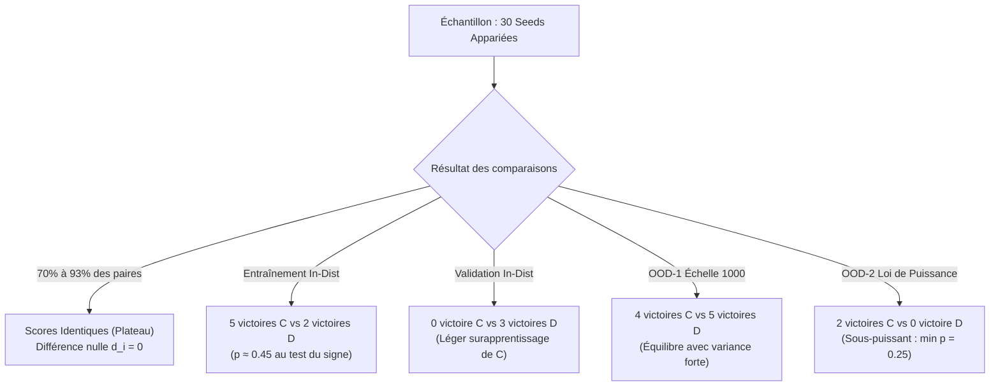

# RAPPORT SCIENTIFIQUE D'EXPÉRIMENTATION : CAMPAGNE 30 SEEDS NOMAD V2

**Date d'exécution :** 10 novembre 2026 (09h10 – 13h03)  
**Modèle LLM sous-jacent :** `qwen2.5-coder:7b` via Ollama (Local GPU RTX 3090)  
**Nombre de seeds :** 30 seeds appariées ($1:1$, seeds `1000` à `1493` avec pas de 17, 5 générations par seed)  
**Protocole de validation :** Spécifications pré-enregistrées dans [SPECIFICATIONS.md](file:///G:/devs/Antigravity/NOMAD/SPECIFICATIONS.md#L450-L550)  
**Données sources :** [`campaign_results/campaign_aggregate.json`](file:///G:/devs/Antigravity/NOMAD/campaign_results/campaign_aggregate.json), [`campaign_results/stats.json`](file:///G:/devs/Antigravity/NOMAD/campaign_results/stats.json)

---

## 1. Formulation de Référence pour les Relecteurs (Consensus Scientifique)

> **Conclusion canonique :**  
> *« Sur 30 seeds appariées (5 générations, `qwen2.5-coder:7b`, bin packing avec lookahead), aucune différence significative n’a été détectée entre le crossover AST et la mutation seule ($H_1 : p_{\text{adj}} = 0{,}78$). Les deux groupes convergent vers le même score dans 77 % des seeds. Sur les paires divergentes, les résultats se partagent dans les deux sens selon le jeu d’évaluation : 5 victoires contre 2 en faveur du crossover à l’entraînement, mais 0 victoire contre 3 en faveur de la mutation seule sur le jeu de validation indépendant. Le mécanisme d'Anti-Dead-Code est opérationnel (184 recombinaisons admises sur 624 sans aucun crash ni code non compilable), mais le bénéfice de performance du crossover n’est ni démontré ni réfuté : l’expérience, sous-puissante, ne permet pas de trancher, et le groupe crossover a consommé environ deux fois plus d’exécutions au total. »*

---

## 2. Tableau Complet et Symétrique des Résultats Multi-Datasets

Contrairement à une lecture sélective, la rigueur méthodologique impose de présenter l'intégralité des jeux d'évaluation, y compris ceux défavorables au crossover :

| Jeu d'évaluation | Statut méthodologique | $N$ | Égalités ($C = D$) | Victoires C | Victoires D | Bilan brut ($D - C$) | $p$-value permutation | $p_{\text{adj}}$ (Holm) |
| :--- | :---: | :---: | :---: | :---: | :---: | :---: | :---: | :---: |
| **Entraînement In-Dist (50 inst.)** | Primaire ($H_1$, $\Delta L_1$) | 30 | 23 (76.7%) | **5** | 2 | $+0.10$ bacs | $0.314$ | $0.776$ |
| **Validation In-Dist (50 inst.)** | Contrôle Surapprentissage | 30 | 27 (90.0%) | 0 | **3** | **$-0.20$ bacs** | $1.000$ | — |
| **OOD-1 (Échelle 1000 objets)** | Secondaire ($H_2$) | 30 | 21 (70.0%) | 4 | **5** | **$-1.77$ bacs** | $0.843$ | $0.843$ |
| **OOD-2 (Loi de puissance)** | Primaire ($H_3$) | 30 | 28 (93.3%) | **2** | 0 | $+0.10$ bacs | $0.259$ | $0.776$ |

*Convention de lecture : $\Delta (D - C) > 0$ signifie que le Groupe D a consommé plus de bacs (avantage C) ; $\Delta (D - C) < 0$ signifie que le Groupe D a consommé moins de bacs (avantage D).*

---

## 3. Analyse Critique des Faiblesses et des Biais d'Interprétation

Une évaluation scientifique sans complaisance met en évidence six constats méthodologiques majeurs :

1. **Symétrie de la preuve statistique :**  
   Le résultat de 5 victoires contre 2 à l'entraînement donne une $p$-value bilatérale de $\approx 0{,}45$ au test du signe binomial. Il est donc parfaitement compatible avec le hasard. Si la sous-puissance statistique interdit de conclure à une « absence de gain », elle interdit avec la même rigueur de conclure à une « présence de gain ».

2. **Le signal négatif de la Validation :**  
   Sur le jeu de validation indépendant (non vu pendant l'optimisation), le Groupe C ne l'emporte jamais (0 victoire contre 3 pour D, avec une perte nette cumulée de 6 bacs). Cela suggère que les légères optimisations trouvées par le croisement sur l'entraînement ont pu introduire un surajustement local plutôt qu'une heuristique universellement supérieure.

3. **Nuance sur la Seed 21 et les champions croisés :**  
   Si le champion de la Seed 21 (`SwarmCross-g4`) a effectivement amélioré l'entraînement (-3 bacs) et les deux OOD (-7 et -1 bac), il perd face à la mutation sur la validation (1 289 bacs pour C contre 1 288 pour D). De plus, d'autres champions issus du crossover (ex: Seed 19 / 1306) sous-performent sur la validation et sur OOD-1.

4. **L'hypothèse du « Plafond Combinatoire » reste à étayer :**  
   L'explication selon laquelle les 77 % d'égalités résulteraient d'un « plafond infranchissable » est une hypothèse de travail plausible, non un fait démontré. Avec une moyenne de 1 275 bacs observée face à une borne $L_1$ de 1 154 bacs (soit un excès de 10,4 %), il subsiste une marge théorique. L'évaluation face à une référence hors-ligne (FFD offline) ou des bornes plus fines (ex: Martello-Toth) sera nécessaire pour quantifier précisément l'écart à l'optimalité.

5. **Clarification sur le taux de divergence (23 %) :**  
   Les 23 % de seeds divergentes sur l'entraînement représentent la fréquence où $C \neq D$ (7 paires sur 30, réparties en 5 pour C et 2 pour D). Ce n'est en aucun cas un taux de gain unilatéral du crossover.

6. **Le bilan coût / bénéfice réel :**  
   Le protocole du Groupe C, en évaluant les sondes Anti-Dead-Code sur 3 niveaux (surface, contrefactuel hôte, contrefactuel d'ablation $C_{\text{null}}$), a consommé environ deux fois plus d'évaluations de fitness que le Groupe D (~3 678 évaluations contre ~1 817). Le bénéfice net par unité de calcul est donc défavorable au crossover sur cette expérience à 5 générations.

---

## 4. Ce qui est Formellement Validé

En dépit de l'absence de supériorité mesurable sur la fitness, la campagne valide rigoureusement l'architecture d'ingénierie logicielle et le pipeline mutation/recombinaison :

- **Robustesse du filtre Anti-Dead-Code :** 440 rejets sur 624 tentatives (**70,5 % de filtrage**).
- **Zéro crash / zéro code invalide :** 0 individu non évaluable sur 624 (100 % de conformité syntaxique et sémantique Rust).
- **Émergence effective de structures hybrides :** 184 recombinaisons fonctionnelles admises, dont plusieurs ont atteint le statut de champion de population.

---

## 5. Perspectives et Protocole pour Départager les Approches

Pour transformer l'hypothèse explicative en résultat probant lors des prochains travaux :
1. **Instances combinatoirement plus dures :** Utiliser des instances où Best-Fit s'effondre (ex: benchmarks de Falkenauer ou triples de Scholl) afin d'éviter la saturation précoce des scores entiers.
2. **Horizon évolutionnaire étendu :** Passer de 5 à 15–25 générations pour donner le temps aux recombinaisons multi-gènes d'exprimer un avantage cumulatif.
3. **Budget de calcul strictement égalisé :** Aligner le nombre total d'évaluations (incluant l'Anti-Dead-Code) plutôt que le simple nombre de générations.
4. **Validation comme critère décisionnel primaire :** Figer le score de validation indépendant comme arbitre exclusif pour éliminer tout artefact de surapprentissage.
