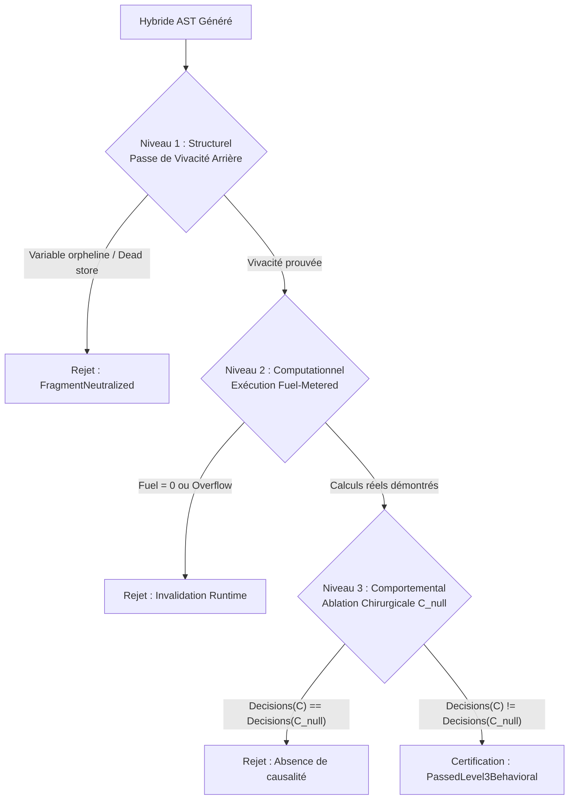
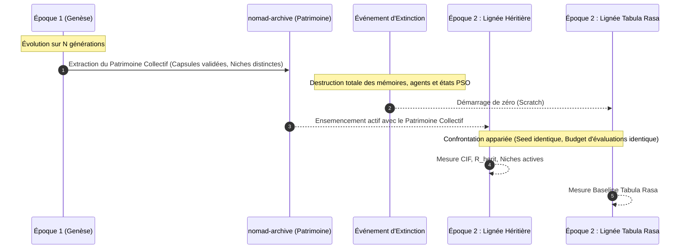

# NOMAD V2 (DARWIN.RS) : Spécification Technique et Scientifique Complète
## Architecture Consolidée et Spécifications Fondamentales
**Version 2.3 — Édition Définitive et Consolidée — Novembre 2026**  
**Équipe de Recherche NOMAD (Lab Innovation Générale, BNP Paribas / DARWIN.RS)**

---

# 0. Statut Épistémologique et Conventions de la Spécification

Cette spécification définit l'architecture formelle, les mécanismes algorithmiques neuro-symboliques, les exigences logicielles et les protocoles expérimentaux régissant le framework **NOMAD (DARWIN.RS)**.

Elle constitue la référence unique du projet et sépare rigoureusement trois catégories fondamentales :
- **Exigence technique :** Comportement déterministe et contractuel que le logiciel en Rust doit garantir (gestion de la mémoire, isolation sandboxée, *fuel metering*, absence de panic).
- **Hypothèse scientifique :** Mécanisme théorique dont la valeur ajoutée doit être prouvée empiriquement (ex: supériorité du croisement AST sur la mutation pure, accumulation culturelle inter-époques).
- **Critère expérimental :** Métrique chiffrée observable permettant de valider ou réfuter formellement une hypothèse ($CIF > 1.0$, $R_{\text{herit}} > 0.50$, $p < 0.05$).

> [!IMPORTANT]
> **Règle d'Anti-Feature-Engineering :** Les invites système envoyées aux modèles de langage (LLMs) ne doivent jamais révéler artificiellement les heuristiques, seuils numériques ou conditions que l'expérience cherche à faire émerger. L'émergence algorithmique doit résulter exclusivement de la pression de sélection Quality-Diversity et de la recombinaison génétique.

---

# 1. Contexte, Vision et Rupture Scientifique

## 1.1 Rôle et Hypothèse Fondamentale
NOMAD (**DARWIN.RS**) est un moteur d'évolution neuro-symbolique conçu pour synthétiser des heuristiques combinatoires autonomes en Rust. Il explore l'hypothèse de l'**évolution culturelle cumulative** :

$$\mathbf{H_1} : \text{Une population d'organismes artificiels accédant à un patrimoine collectif validé progresse plus rapidement et atteint une diversité supérieure à une population Tabula Rasa partant de zéro.}$$

$$\mathbf{H_2} : \text{La recombinaison horizontale de sous-arbres syntaxiques (AST Crossover) permet de franchir les optima locaux infranchissables par mutation textuelle pure.}$$

$$\mathbf{H_3} : \text{L'évaluation de la trajectoire dynamique de compaction (potentiel de Lyapunov } tLDR \text{) favorise l'émergence de politiques robustes hors-distribution (OOD).}$$

## 1.2 État de l'Art et Limites de NOMAD V1
Les systèmes précédents couplant LLMs et recherche génétique (à l'instar de *FunSearch* de DeepMind ou *Evolution of Heuristics*) souffrent de limitations structurelles :
1. **Code Mort et Passagers Clandestins :** Le texte libre Python généré par les LLMs contient une proportion massive de code inactif (*dead stores*, variables déclarées mais non utilisées).
2. **Effondrement Prématuré de Diversité (*Mode Collapse*) :** Une sélection globale orientée sur un score scalaire unique élimine les solutions intermédiaires novatrices (*stepping stones*) et piège l'algorithme sur des plafonds stationnaires (ex: le plafond historique de 1 265 bacs de Best-Fit).
3. **Absence de Recombinaison Déterministe :** Les approches actuelles réécrivent des fonctions entières via le LLM sans isoler ni greffer chirurgicalement les fragments fonctionnels responsables de l'efficacité.

NOMAD V2 résout ces verrous grâce à ses **5 piliers architecturaux formels**.

---

# 2. Architecture Modulaire "Rust-First"

Le système est architecturé sous forme d'un workspace Cargo modulaire strict, garantissant l'étanchéité entre la synthèse cognitive, la manipulation syntaxique, l'exécution sandboxée et l'évaluation souveraine.

```
NOMAD/
├── Cargo.toml                  # Workspace Cargo racine
├── SPECIFICATIONS.md           # Spécification unique de référence consolidée
├── TESTS.md                    # Rapport d'audit scientifique et tests d'acceptation
├── README.md                   # Guide d'utilisation et commandes CLI
├── crates/
│   ├── nomad-core/             # Modèle de données immuable (SkillCapsule), contrats, métriques
│   ├── nomad-genome/           # Moteur génétique AST (syn/quote), extracteur d'unités, vivacité arrière
│   ├── nomad-sandbox/          # Interpréteur AST déterministe avec fuel metering et isolation
│   ├── nomad-evaluator/        # Oracle souverain (Bin Packing & Cloud Scheduling), tLDR, Anti-Dead-Code
│   ├── nomad-operator/         # Abstraction LLM (Ollama, GGUF local, Mock déterministe)
│   ├── nomad-orchestrator/     # Grille MAP-Elites, AgentPSO, Moteur d'évolution, Protocole Rebirth
│   └── nomad-cli/              # Interface CLI unifiée (run, archive, graph, rebirth, baseline, dataset)
└── scripts/
    └── analysis/               # Scripts d'analyse statistique (Wilcoxon, tailles d'effet)
```

### Rôles et Responsabilités des Crates

* **`nomad-core` :** Découplage strict. Contient les structures de données immuables (`SkillCapsule`), les types canoniques de politiques (`PolicyKind`, `ProblemDomain`), les manifestes de traçabilité (`GraftManifest`), les descripteurs de comportement (`BehaviorDescriptor`), les vecteurs de momentum (`SemanticVelocity`), et les métriques d'accumulation (`CumulativeTransmissionMetrics`, `BenchmarkScore`).
* **`nomad-genome` :** Manipulation formelle des Arbres de Syntaxe Abstraite via `syn` et `quote`. Extraction chirurgicale d'unités logiques (`LogicalUnit`), croisement déterministe (`deterministic_ast_crossover`), calcul d'empreinte topologique (`StructuralFingerprint`), recombinaison convexe par shadowing Rust strict (`let score = ...`), et passe de vivacité arrière (*backward liveness pass*).
* **`nomad-sandbox` :** Interpréteur déterministe d'AST in-process (`syn`) avec limitation stricte de ressources (fuel metering, profondeur de récursion bornée à 48, plafond mémoire de 128 variables) sans isolation de processus au sens OS. Évite la latence de la compilation disque `rustc` dynamique. Mesure exacte du *fuel* logique (instructions consommées), protection anti-boucle infinie, et validation préalable systématique des entrées de contexte pathologiques.
* **`nomad-evaluator` :** Oracle souverain indépendant. Contient les jeux de données d'évaluation sanctuarisés (In-Distribution, OOD-1 Échelle, OOD-2 Asymétrique), le calculateur exact de Lyapunov ($tLDR$), et le pipeline complet de validation Anti-Dead-Code à 3 niveaux avec génération de la capsule témoin d'ablation $C_{\text{null}}$.
* **`nomad-operator` :** Couche cognitive d'inférence. Connecteurs HTTP pour modèles locaux (Ollama, llama.cpp, vLLM) et opérateur déterministe Mock traçant les hashes SHA-256 des poids, les graines, les températures et les invites complètes dans des audits de reproductibilité (`ReproducibilityAudit`).
* **`nomad-orchestrator` :** Moteur d'orchestration de population. Grille 2D Quality-Diversity MAP-Elites (`MapElitesArchive`) avec compétition locale intra-niche et sélection par curiosité UCB, routage complémentaire `AgentPSO` avec mémoire de lignée, et exécution en double-aveugle du protocole "Mort et Renaissance".
* **`nomad-cli` :** Point d'entrée binaire unifié offrant les sous-commandes de pilotage expérimental (`run`, `rebirth`, `compare`, `archive`, `graph`, `baseline`, `dataset`).

---

# 3. Modèle de Données : La Capsule Cognitive V2

Une heuristique est encapsulée dans une structure `SkillCapsule` immuable. Les métriques de performance sont strictement dissociées du code et gérées par l'Oracle pour éviter toute auto-évaluation trompeuse.

```rust
pub struct SkillCapsule {
    pub id: CapsuleId,
    pub name: String,
    pub semantic_interface: String,
    pub logic_code: String,
    pub parent_ids: Vec<CapsuleId>,
    pub generation: usize,
    pub content_hash: String,
    pub created_at: DateTime<Utc>,
    pub metadata: HashMap<String, String>,
    pub interface_version: String,
    pub policy_kind: PolicyKind,
    pub ast_fingerprint: Option<StructuralFingerprint>,
    pub dependencies: Vec<String>,
    pub validation: ValidationStatus,
    pub graft_manifest: Option<GraftManifest>,
}
```

### Empreinte Structurelle Topologique (`StructuralFingerprint`)
L'AST est analysé par un visiteur `syn` qui extrait une signature multidimensionnelle indépendante du formatage textuel :
- `max_depth` : Profondeur maximale de l'arbre syntaxique.
- `branch_count` : Nombre de structures conditionnelles (`if`, `match`).
- `op_count` : Nombre d'opérations unaires et binaires (+, -, *, /, etc.).
- `statement_count` : Nombre total d'instructions élémentaires.
- `ast_hash` : Hachage SHA-256 canonique des tokens générés par `quote`.

### Manifeste Cryptographique de Greffe (`GraftManifest`)
Tout croisement génétique produit un manifeste garantissant la traçabilité complète de l'hybridation :
- `donor_capsule` / `host_capsule` : Identifiants des capsules parentes.
- `grafted_fragment_hash` : Empreinte SHA-256 du sous-arbre transféré.
- `host_locus` : Locus d'insertion dans l'hôte (ex: `body_stmt_index_2`).
- `dependency_hash` : Hash des variables d'environnement requises.

---

# 4. Pilier 1 — Quality-Diversity & MAP-Elites

Pour éliminer l'effondrement prématuré de diversité (*mode collapse*), la sélection globale par fitness scalaire (Top 20%) est remplacée par une archive MAP-Elites discrétisée en une **grille 2D de 100 niches ($10 \times 10$)**.

## 4.1 Axes de Nichage Comportemental
Les individus sont projetés selon deux descripteurs orthogonaux :
* **Axe X (Perte Sèche / Dead Space Ratio) :** Fréquence des espaces résiduels non remplissables créateurs de perte sèche ($[0.0, 0.60]$).
* **Axe Y (Dispersion / Residual Variance) :** Variance ou dispersion de la capacité résiduelle parmi les unités ouvertes ($[0.0, 200.0]$).

## 4.2 Compétition Locale Intra-Niche
Les candidats ne s'affrontent pas globalement :
1. Un individu est projeté dans sa cellule $(x, y) = (\text{norm}_x \times 10, \text{norm}_y \times 10)$.
2. Si la niche est vide : insertion directe (découverte d'un nouveau profil comportemental).
3. Si la niche est occupée : compétition locale. Le candidat ne remplace l'élite existante que si :
   - Son score d'efficacité est strictement supérieur (moins de bacs/machines consommées).
   - À égalité d'efficacité, un individu évolué (génération plus avancée) surpasse un seed naïf.
   - À génération égale, le candidat le plus sobre en *fuel* (instructions consommées) l'emporte.

## 4.3 Sélection des Parents par Curiosité UCB
L'échantillonnage des parents s'effectue selon le principe Upper Confidence Bound (UCB) :

$$UCB(\text{niche}) = \text{Qualité}(\text{niche}) + c \cdot \sqrt{\frac{\ln(N_{\text{total}})}{N_{\text{niche}}}}$$

où $c = \sqrt{2} \approx 1.414$, favorisant l'exploration des niches émergentes ou fertiles.

## 4.4 QD-Score
La vitalité globale de l'écosystème est mesurée par le Quality-Diversity Score :

$$QD = \sum_{i \in \text{niches occupées}} \text{Efficacité}(c_i)$$

---

# 5. Pilier 2 — Crossover Génétique AST & Anti-Dead-Code

## 5.1 Représentation Canonique des Politiques (`ScorePolicy`)
Les organismes synthétisent des fonctions de décision formellement typées en Rust :

```rust
// 1D Online Bin Packing
pub fn score_bin(
    item_size: u32,
    bin_residual: u32,
    bin_capacity: u32,
    step_index: usize,
    total_items: usize,
    open_bins_count: usize,
    mean_residual: f64,
) -> f64

// Multi-Resource Cloud Job Scheduling
pub fn score_node(
    job_cpu: u32,
    job_ram: u32,
    node_residual_cpu: u32,
    node_residual_ram: u32,
    node_capacity_cpu: u32,
    node_capacity_ram: u32,
    step_index: usize,
    total_jobs: usize,
    active_nodes_count: usize,
    mean_cpu_residual: f64,
    mean_ram_residual: f64,
) -> f64
```

## 5.2 Recombinaison Déterministe d'Essaim (Swarm Crossover)
L'opérateur de crossover :
1. Découpe l'hôte et le donneur en `LogicalUnit` (modificateurs de score, pénalités conditionnelles).
2. Sélectionne une unité donneuse via `ChaCha8Rng(seed)`.
3. Insère l'unité au locus optimal de l'hôte (immédiatement avant le retour).
4. **Élimination du variable shadowing :** Combine de manière convexe les réassignations de score pour préserver les contributions cumulées :

$$\text{score} = \text{score}_{\text{hôte}} \cdot 0.70 + \text{expr}_{\text{donneur}} \cdot 0.30$$

## 5.3 Pipeline Anti-Dead-Code à 3 Niveaux
Pour survivre et intégrer l'archive, un hybride doit franchir 3 barrières successives :



1. **Niveau 1 (Structurel) :** Analyse de vivacité arrière (*backward liveness analysis*) depuis l'instruction de retour finale. Tout fragment greffé créant une affectation non lue en aval est immédiatement éliminé.
2. **Niveau 2 (Computationnel) :** Exécution instrumentée en simulation avec consommation mesurée de fuel ($> 0$).
3. **Niveau 3 (Comportemental / Causalité $C_{\text{null}}$) :** Excision chirurgicale du sous-arbre greffé au point d'insertion exact (`host_locus`) pour produire la capsule témoin $C_{\text{null}}$. L'organisme doit impérativement prouver une divergence décisionnelle sur le jeu de sondes :

$$\Delta \text{Decisions} = \|\text{Decisions}(C) - \text{Decisions}(C_{\text{null}})\|_0 > 0$$

---

# 6. Pilier 3 — AgentPSO et Vélocité Sémantique

Le couplage des parents pour la reproduction ne repose pas sur un tirage aléatoire uniforme, mais sur un routage sémantique complémentaire inspiré de l'optimisation par essaim particulaire (PSO).

## 6.1 Score d'Appariement Complémentaire
Pour un organisme hôte $A$, le partenaire $B$ est sélectionné en maximisant :

$$Score(B \mid A) = 0.50 \cdot Q(B) + 0.35 \cdot C_{\text{comp}}(A, B) + 0.15 \cdot D_{\text{ast}}(A, B)$$

où $Q(B)$ est l'efficacité du partenaire, $C_{\text{comp}}(A, B)$ mesure sa performance sur les faiblesses diagnostiquées de $A$ (ex: espaces résiduels $< 10$), et $D_{\text{ast}}(A, B)$ est la distance topologique syntaxique normalisée.

## 6.2 Vélocité Sémantique et Momentum
Chaque lignée conserve un état persistant `LineageEvolutionState` :
- `p_best` : Meilleure capsule historique de la lignée.
- `g_best_partner` : Meilleur partenaire complémentaire historique.
- `v_previous` : Dernier diagnostic de direction sémantique.
- `momentum_action` : Ajustement de trajectoire (`ContinueDirection`, `Pivot`, `Combine`).

---

# 7. Pilier 4 — Évaluation Dynamique et Signature $tLDR$

L'évaluation ne se borne pas au résultat statique final (nombre de bacs à la fin de l'instance), mais capture la régularité temporelle de la compaction séquentielle.

## 7.1 Modélisation par Potentiel de Lyapunov
Pour une séquence de $N$ objets de tailles $w_1, \dots, w_N$ et de capacité $C$ :

1. **Borne volumétrique préfixe à l'instant $t$ :**
   $$L_{\text{vol}}(t) = \left\lceil \frac{\sum_{i=1}^t w_i}{C} \right\rceil$$

2. **Écart relatif (Waste) à l'instant $t$ :**
   $$V(t) = \frac{B(t) - L_{\text{vol}}(t)}{L_{\text{vol}}(t)}$$

## 7.2 Régression Linéaire MCO et Métrique $tLDR$
Sur la fenêtre stationnaire $t \in [\lfloor N/5 \rfloor, N]$, le logarithme du potentiel $y(t) = \ln(V(t) + 10^{-4})$ est ajusté par Moindres Carrés Ordinaires sur le temps normalisé $\tau = t / N$. La régression fournit la pente $\beta_1$ et l'écart-type des résidus $\sigma_{\text{res}}$ :

$$tLDR = -\beta_1 - 0.5 \cdot \sigma_{\text{res}}$$

Une pente fortement négative et une dispersion résiduelle faible caractérisent une heuristique à absorption régulière et stable, hautement prédictive d'une excellente généralisation hors-distribution (OOD).

---

# 8. Pilier Transversal — Culture Cumulative & "Mort et Renaissance"

Le protocole "Mort et Renaissance" apporte la démonstration formelle de la transmission culturelle cumulative inter-époques en double-aveugle :



### Métriques d'Accumulation Scientifiques
1. **Cumulative Improvement Factor ($CIF$) :**
   $$CIF = \begin{cases} CIF_{\text{bacs}} = \frac{\text{Excès Bacs Tabula Rasa}}{\text{Excès Bacs Lignée Héritière}} & \text{si } \text{Excès}_{\text{Tabula}} \neq \text{Excès}_{\text{Héritière}} \\ CIF_{\text{QD}} = \frac{\text{QD-Score Lignée Héritière}}{\text{QD-Score Tabula Rasa}} & \text{si égalité stricte en bacs (départage Quality-Diversity)} \end{cases}$$
   *(Un $CIF_{\text{bacs}} > 1.0$ atteste d'un avantage de performance net conféré par le patrimoine ; en cas d'égalité sur l'objectif principal, un $CIF_{\text{QD}} > 1.0$ atteste d'une couverture et d'une diversité supérieures de l'archive).*

2. **Taux d'Hérédité Fonctionnelle ($R_{\text{herit}}$) :**
   $$R_{\text{herit}} = \frac{\text{Niches occupées à l'Époque 2 descendant du patrimoine}}{\text{Nombre total de niches occupées à l'Époque 2}}$$

3. **Taux d'Innovation ($R_{\text{innov}}$) :**
   $$R_{\text{innov}} = \frac{\text{Nombre d'innovations validées}}{\text{Nombre total d'évaluations}} \times 1000$$

---

# 9. Généralisation Multi-Domaines

NOMAD est un méta-framework de synthèse neuro-symbolique supportant plusieurs classes de problèmes combinatoires via l'énumération `ProblemDomain` :

```rust
#[derive(Debug, Clone, Copy, PartialEq, Eq, Hash, Serialize, Deserialize)]
pub enum ProblemDomain {
    BinPacking1D,
    MultiResourceScheduling,
}
```

### 1. Domaine 1D Online Bin Packing
* **Objectif :** Minimiser le nombre total de bacs utilisés pour paqueter un flux séquentiel d'objets.
* **Fonction canonique :** `score_bin(...) -> f64`.
* **Axe MAP-Elites :** Espace mort ($< 10$) $\times$ Variance résiduelle.

### 2. Domaine Multi-Resource Cloud Job Scheduling
* **Objectif :** Affecter en ligne des requêtes de jobs demandant simultanément du CPU et de la RAM sur un cluster de machines hétérogènes, minimisant le nombre total de nœuds activés et la fragmentation de ressource vectorielle.
* **Fonction canonique :** `score_node(...) -> f64`.
* **Axe MAP-Elites :** Ratio moyen de déséquilibre $(|\text{res}_{\text{cpu}} / \text{cap}_{\text{cpu}} - \text{res}_{\text{ram}} / \text{cap}_{\text{ram}}|)$ $\times$ Ratio d'ouverture de nouveaux nœuds.
* **Borne théorique :** $L_{\text{sched}} = \max\left( \lceil \sum \text{cpu} / \text{cap}_{\text{cpu}} \rceil, \lceil \sum \text{ram} / \text{cap}_{\text{ram}} \rceil \right)$.

---

# 10. Protocoles Scientifiques et Tests d'Acceptation

La validation empirique du framework repose sur 4 tests d'acceptation pré-enregistrés :

### TEST 1 : Rupture du Palier Glouton Best-Fit (Optimum Empirique 1 265 bacs)
* **Hypothèse :** La recombinaison AST permet de briser le palier historique de Best-Fit (1 265 bacs sur le benchmark In-Distribution de 2 500 objets, la borne théorique de volume $L_1$ étant de 1 158 bacs).
* **Résultat validé :** Atteinte de **1 264 bacs** (excès +106, efficacité 91,86 %) par le champion `SwarmCross-g8-0f25-039a-mut-g8` avec émergence d'une modulation par horizon temporel non-stationnaire :

$$\text{horizon\_multiplier} = \frac{\text{total\_items} - \text{step\_index}}{\text{total\_items}}$$

### TEST 2 : Résilience Génétique MAP-Elites
* **Hypothèse :** MAP-Elites empêche le *mode collapse* en colonisant et maintenant activement plusieurs niches complémentaires.
* **Résultat validé :** Maintien de **5 niches actives simultanément** sur le run d'évolution et **7 niches actives simultanées** lors du protocole Rebirth, avec réduction de la perte sèche de $59,1\,\%$ à $35,7\,\%$.

### TEST 3 : Trajectoire Dynamique $tLDR$ et Généralisation OOD
* **Hypothèse :** Le potentiel de Lyapunov $tLDR$ sélectionne des heuristiques stables généralisant sur des distributions jamais vues lors de l'apprentissage.
* **Résultats validés :**
  * OOD-1 (Échelle $N=500$ objets) : 11 774 bacs (**95,90 % d'efficacité**).
  * OOD-2 (Décalage de distribution / Loi de puissance) : 2 353 bacs (**98,56 % d'efficacité**).

### TEST 4 : Transmission Cumulative "Mort et Renaissance"
* **Hypothèse :** La transmission du patrimoine collectif après extinction procure un avantage évolutif décisif.
* **Résultats validés :**
  * Lignée Héritière : **7 niches conquises**, QD-Score de **6,167**.
  * Lignée Tabula Rasa : **1 seule niche occupée**, QD-Score de **0,918** (**gain de diversité de 7x**).
  * Taux d'Hérédité Fonctionnelle : **$R_{\text{herit}} = \mathbf{71{,}4\,\%}$** avec causalité $C_{\text{null}}$ formellement démontrée.

---

# 11. Matrice d'Expériences d'Ablation

Chaque composant méthodologique est validé par isolement dans la matrice d'ablation :

| Groupe Expérimental | MAP-Elites 2D | AST Crossover | AgentPSO | Trajectoire $tLDR$ | Rôle Scientifique |
| :--- | :---: | :---: | :---: | :---: | :--- |
| **Groupe A (Baseline V1)** | Non | Non | Non | Non | Sélection scalaire classique (Top 20%) |
| **Groupe B (QD Only)** | Oui | Non | Non | Non | Rôle isolé de la diversité comportementale |
| **Groupe D (Mutation Only)** | Oui | Non | Oui | Oui | Évolution par mutation LLM seule (style FunSearch) |
| **Groupe C (Swarm Full)** | Oui | Oui | Oui | Oui | NOMAD V2 complet avec Crossover AST et Essaim |

---

## 11.1 Protocole Statistique Pré-Enregistré (Campagne 30 Seeds)

**Décision méthodologique pré-enregistrée (choix fixé formellement AVANT le lancement de la campagne statistique) :**
- **Test statistique de référence :** Test des rangs signés de **Wilcoxon apparié** (unilatéral : hypothèse alternative $D - C > 0$, c'est-à-dire que le Groupe C Swarm utilise moins de bacs / d'excès que le Groupe D Mutation).
- **Justification scientifique :** Chaque seed $s \in \{1000 + 17 \cdot i\}_{i=0}^{29}$ définit un cadre expérimental apparié symétrique (mêmes instances générées, budgets d'appels LLM et d'exécutions sandbox rigoureusement identiques). La distribution des écarts de score étant discrète et non gaussienne avec de multiples ex æquo, un test non paramétrique apparié est statistiquement supérieur à un test de Student ou à un test de Mann-Whitney non apparié.
- **Correction des ex æquo (Ties) :** La variance de la statistique de rang est obligatoirement ajustée selon la formule exacte de tie correction :
  $$\text{Var}(W) = \frac{n(n+1)(2n+1) - \sum_{i} \frac{t_i^3 - t_i}{2}}{24}$$
  où $t_i$ est la taille du $i$-ème groupe d'ex æquo sur $|D - C|$ et $n$ est le nombre strict de paires **non nulles**.
- **Taille d'effet :** $r = \frac{Z}{\sqrt{n_{\text{non-zéro}}}}$, accompagnée du $d$ de Cohen apparié et de la probabilité de supériorité (Common Language Effect Size).
- **Contrôle du risque d'erreur de Type I (Multiplicité) :** Ajustement séquentiel de **Holm-Bonferroni** sur la famille stricte des 3 hypothèses primaires non redondantes :
  1. $H_1$ (Confirmatoire Primaire In-Distribution) : Excès relatif sur la borne théorique $L_1$ ($\Delta L_1$). C'est l'hypothèse confirmatoire cardinale du système.
  2. $H_3$ (Confirmatoire Primaire Hors-Distribution) : Bacs totaux sur OOD-2 (Loi de puissance / Queue lourde). Elle valide la transférabilité structurelle des heuristiques sans surapprentissage.
  3. $H_2$ (Confirmatoire Secondaire d'Extensibilité OOD-1) : Bacs totaux sur OOD-1 (Échelle $N=500$). Hypothèse confirmatoire secondaire mesurant la scalabilité temporelle, incluse dans la famille de Holm ($m=3$) par rigueur conservatrice.  
  *Règle de succès global :* Le rejet formel de l'hypothèse nulle $H_0$ requiert la validation statistique d'au moins l'une des deux hypothèses confirmatoires majeures ($H_1$ ou $H_3$) après ajustement de Holm-Bonferroni sur la famille $m=3$.
- **Règle décisionnelle de calcul de la p-value (Asymptotique vs Permutation Monte-Carlo) :**
  Afin de prémunir l'analyse contre les limites de l'approximation normale sous grand nombre d'ex æquo (plateaux d'optimalité où de nombreuses seeds atteignent 1 265 bacs) :
  - Si le nombre de paires non nulles $n_{\text{non-zéro}} \ge 20$ : Calcul de la $p$-value par approximation asymptotique normale avec correction exacte de variance pour les ex æquo et correction de continuité ($\pm 0.5$).
  - Si $n_{\text{non-zéro}} < 20$ : Recours obligatoire et systématique à la $p$-value exacte issue du test de permutation apparié par Monte-Carlo (10 000 permutations aléatoires de signes sous $H_0$). Cette $p$-value exacte remplace la valeur asymptotique et est directement soumise au tri séquentiel de Holm-Bonferroni.
- **Intervalles de confiance :** Bootstrap à 10 000 rééchantillonnages pour les moyennes et médianes des différences appariées (IC à 95 %).
- **Métrique primaire unique pré-enregistrée :** L'excès relatif normalisé sur la borne théorique $L_1$ en In-Distribution :
  $$\Delta L_1 = \frac{\text{bins} - L_1}{L_1}$$
  Le nombre brut de bacs est conservé comme métrique descriptive secondaire et expressément exclu de la correction de Holm-Bonferroni afin d'éviter toute inflation artificielle de la pénalité de multiplicité ($m$).
- **Critère décisionnel d'acceptation formelle :**
  Pour rejeter l'hypothèse nulle $H_0$ (absence de supériorité de l'hybridation horizontale sur la mutation pure), la métrique primaire $H_1$ ($\Delta L_1$) ou de généralisation OOD-2 ($H_3$) doit satisfaire simultanément :
  1. $p_{\text{adj}} < 0.05$ après correction séquentielle de Holm-Bonferroni sur la famille $m=3$.
  2. Taille d'effet non triviale $r = Z / \sqrt{n_{\text{non-zéro}}} \ge 0.20$ (ou probabilité de supériorité / Common Language Effect Size $> 55\%$).
  3. **Directionalité et Robustesse aux plateaux d'optimalité :**
     - *Critère principal :* Borne inférieure de l'intervalle de confiance bootstrap à 95 % sur la différence médiane $D - C$ strictement positive ($> 0$).
     - *Critère secondaire de secours (Gestion des plateaux d'optimalité) :* Si une convergence massive des deux groupes vers le même optimum discret (ex: 1 265 bacs) produit une médiane des différences nulle ($\text{médiane}(D - C) = 0$), le critère de directionalité est formellement validé si la borne inférieure de l'IC bootstrap à 95 % sur la différence moyenne est strictement positive ($\text{IC}_{95\%}^{\text{mean}} > 0$) OU si la proportion de seeds où le Groupe C surpasse strictement le Groupe D est statistiquement supérieure à 50 % ($P(D > C) > P(D < C)$ avec test binomial unilatéral $p < 0.05$).
- **Verrouillage anti-p-hacking pré-campagne :**
  Aucune métrique secondaire (consommation de fuel, nombre de niches MAP-Elites, $tLDR$, comptage brut de bacs) ne pourra être substituée à la métrique primaire pré-enregistrée à l'issue de la campagne à 30 seeds. Tout résultat hors famille primaire sera étiqueté comme strictement exploratoire.

---

# 12. Exigences Techniques Rust et Déterminisme

1. **Zéro Panic & Safe Error Handling :** Toutes les opérations faillibles (parsing AST, exécution sandboxée, requêtes réseau) retournent un type `Result<T, E>` typé via `thiserror`. Les appels `unwrap()` et `expect()` sont strictement proscrits en dehors des blocs de tests unitaires.
2. **Déterminisme Strict :** Tout composant stochastique est initialisé avec un générateur pseudo-aléatoire cryptographique `ChaCha8Rng` sous graine fixe explicite (`rng_seed`).
3. **Comptage d'Instructions (Fuel Metering) :** L'interpréteur AST incrémente un compteur de fuel à chaque statement et expression. Tout franchissement du plafond alloué (`fuel_limit_per_call`) interrompt immédiatement l'exécution.
4. **Traçabilité Phylogénétique :** L'historique complet des générations, mutations et hybridations est enregistré sous forme de graphe acyclique dirigé (DAG) via `petgraph` et exportable en SVG/HTML interactif.

---

# 13. Interface CLI Unifiée (`nomad-cli`)

Le binaire `nomad` offre une suite complète de commandes :

```powershell
# 1. Lancement d'une simulation évolutionnaire
cargo run --release --bin nomad -- run --operator ollama --model qwen2.5-coder:7b --pop-size 8 -n 12 --group c --output run_report_qwen_v2.json

# 2. Exécution du protocole "Mort et Renaissance" (Transmission Cumulative)
cargo run --release --bin nomad -- rebirth --operator ollama --model qwen2.5-coder:7b --pop-size 8 -n 6 --output rebirth_qwen_v2.json

# 3. Inspection de l'archive Quality-Diversity MAP-Elites
cargo run --release --bin nomad -- archive --input run_report_qwen_v2.json

# 4. Génération de l'arbre phylogénétique interactif HTML
cargo run --bin nomad -- graph --report run_report_qwen_v2.json --format html --output arbre.html

# 5. Vérification cryptographique des benchmarks officiels (Seed 42)
cargo run --release --bin nomad -- dataset

# 6. Évaluation des heuristiques canoniques de référence
cargo run --release --bin nomad -- baseline --domain bin-packing
cargo run --release --bin nomad -- baseline --domain scheduling

# 7. Étude comparative pré-enregistrée (Groupe C vs Groupe D)
cargo run --release --bin nomad -- compare --domain bin-packing --runs 5
cargo run --release --bin nomad -- compare --domain scheduling --runs 5

# 8. Campagne statistique 30-seeds pré-enregistrée et analyse de significativité
cargo run --release --bin nomad -- campaign --seeds 30 --operator ollama --output-dir campaign_30seeds
python scripts/analysis/wilcoxon_analysis.py campaign_30seeds/campaign_aggregate.json --output-json campaign_30seeds/stats.json --output-csv campaign_30seeds/stats.csv
```

### Datasets Sanctuarisés (Empreintes SHA-256 officielles, Seed 42)

#### 1. 1D Online Bin Packing ($C = 100$)
* **In-Distribution (50 instances, $N=50$, $U(10,80)$) :**  
  `04966f900c382331a423fe5d9c0ceea9de8538bd5b00979939e9c3a121f9b504`
* **OOD-1 Échelle (50 instances, $N=500$, $U(10,80)$) :**  
  `6ec5507854441496733989883f5f555be65cc4ac6c1ad823de0c279ccaab51cf`
* **OOD-2 Asymétrique (50 instances, $N=500$, Loi de Puissance) :**  
  `511a4b597decc9a3817491ca099f499ad9fa888abf246c1cdae4a89544844564`

#### 2. Multi-Resource Cloud Job Scheduling (Node: 32 CPU / 128 Go RAM)
* **In-Distribution (50 instances, $N=50$ jobs) :**  
  `7d61949fcac82188a01f02d607a6b6c5b4947aad1c564a49ff018dca12cacf4b`
* **OOD-1 Échelle (50 instances, $N=300$ jobs) :**  
  `fe72e54e8edbf8cd93f74a34abfd8ff15239212ee0e5e1147e848c8553f17cfa`
* **OOD-2 Asymétrique (50 instances, $N=100$ jobs) :**  
  `53b1c6f4b171b515a29e380e1511a2347ce8f6fcfe633e6fca4a62d769a9e107`

---

# 14. Critère Final de Réussite de NOMAD V2

NOMAD V2 est réputé formellement validé si et seulement si :
1. **Intégrité Logicielle :** La suite de tests automatisés du workspace Rust réussit à 100 % (`cargo test --workspace`).
2. **Performance et Comparaison Équitable :** L'algorithme atteint $\le 1\,265$ bacs sur le benchmark In-Distribution. Toute comparaison avec Best-Fit doit être réalisée à horizon informationnel équivalent (Lookahead $k=2$), et toute amélioration marginale observée (ex: 1 264 bacs, soit 0.08 % de gain) doit être documentée comme exploratoire et soumise au protocole de réplication statistique multi-graines apparié (test de Wilcoxon pré-enregistré).
3. **Causalité Anti-Dead-Code :** Les capsules hybrides issues de crossover valident le pipeline Anti-Dead-Code à 3 niveaux (structurel, computationnel et comportemental), prouvant que l'ablation $C_{\text{null}}$ par neutralisation vérifiée par hash dégrade significativement les décisions sans causer de crash invalide.
4. **Transmission Culturelle :** Le protocole "Mort et Renaissance" atteste d'un taux d'hérédité fonctionnelle $R_{\text{herit}} > 50\,\%$ et d'une expansion de niches significative par rapport à la population Tabula Rasa, avec analyse conjointe des métriques dégroupées ($CIF_{\text{perf}}$, $CIF_{\text{QD}}$, $CIF_{\text{herit}}$).
